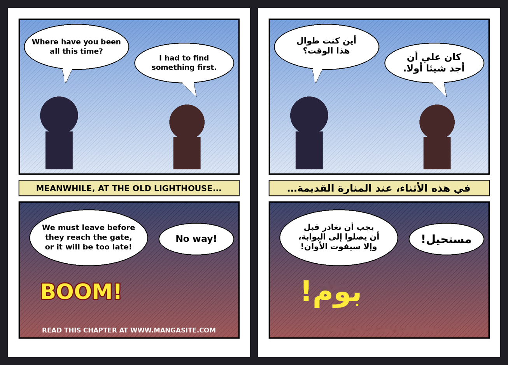

<div align="center">

# 📖 مترجم الكوميكس والمانهوا
### إنجليزي ← عربي · ترجمة جمناي · بنقرتين

اسحب الصفحات ← يقرأ النص ← يمسحه مع الحفاظ على الرسم ← جمناي يترجم الصفحة كاملة بطلب واحد ← تُكتب العربية في نفس مربع النص بنفس اللون.



<sub>مثال مولَّد بالبرنامج على صفحة تجريبية (يمين: الأصل، يسار: النتيجة).</sub>

</div>

---

## 📑 المحتويات

| الدليل | ما فيه |
|--------|--------|
| [التثبيت والتجميع](docs/INSTALL.md) | تشغيل من الكود أو ملف exe جاهز |
| [مفاتيح جمناي](docs/GEMINI.md) | مفتاح مجاني، عدة مفاتيح، الحدود |
| [دليل الاستخدام](docs/USAGE.md) | الترجمة، التعديل، الخطوط، التصدير |
| [بناء ملف exe ونشره على GitHub](docs/BUILD.md) | نقرة واحدة للتجميع، Release تلقائي |
| [حل المشاكل](docs/TROUBLESHOOTING.md) | أخطاء المفتاح، البطء، ضغط الجهاز |
| [أسئلة شائعة](docs/FAQ.md) | LaMa، الخصوصية، سطر الأوامر |
| [الشرح التقني (EN)](docs/ARCHITECTURE.md) | بنية الكود |

---

## ✨ المميزات

- **🤖 الترجمة بجمناي فقط:** مفتاح واحد أو عدة مفاتيح (واحد في كل سطر)، وبرومت مخصص للمانهوا.
- **📦 طلب واحد للصفحة:** كل النصوص المكتشفة تُرسل معًا بحسب عددها، والجواب JSON منسّق يقرؤه البرنامج مباشرة. بحد أقصى طلب واحد في الثانية.
- **📐 لا تخمين للفقاعات:** الترجمة تُكتب في **نفس مربع النص المكتشف**. يتوسع المربع فقط داخل مساحة فارغة مؤكدة بنفس لون الخلفية، فلا يخرج النص من الفقاعة أبدًا.
- **🔠 خط مقروء:** جمناي يتلقى حدًّا لعدد الأحرف لكل مربع، فيختصر العربية حين يكون المربع صغيرًا.
- **📝 تعليماتك:** حقل للملاحظات (أسماء الشخصيات، النبرة، قاموس) يُضاف للبرومت.
- **🎨 نفس لون النص الأصلي** أسود أو أبيض أو ملوّن.
- **🧽 مسح نظيف** يحافظ على الخلفية والتظليل؛ وLaMa يعمل بخفة (خيوط محدودة وأولوية منخفضة) ولا يخنق الجهاز.
- **🚫 يتجاهل الحقوق:** نصوص مثل «اقرأ على site.com» تُمسح بدون ترجمة.
- **📦 تطبيق جاهز:** `build_windows.bat` يبني `ComicTranslator.exe`، وGitHub Actions يبنيه ويرفعه Release تلقائيًا.

---

## ⚡ ابدأ

**الأسهل (ويندوز):** من صفحة [Releases](https://github.com/fang3yuan/comic-translator-app/releases/latest) نزّل **`ComicTranslator-Setup.exe`** وشغّله: يثبّت البرنامج ويضع اختصارًا على سطح المكتب. لا يحتاج بايثون.

**بديل:** نزّل المشروع (Code ▸ Download ZIP) وانقر **`Install.bat`**: يحمّل آخر إصدار ويثبّته تلقائيًا.

**من الكود:**

| نظامك | ماذا تفعل |
|-------|-----------|
| 🪟 ويندوز | انقر مرتين على **`Start.bat`** |
| 🍎 ماك / 🐧 لينكس | `bash start.sh` |

ثم:
1. من تبويب **Translation** اضغط **Get a free key** وأنشئ مفتاحًا من Google AI Studio والصقه (التفاصيل في [GEMINI.md](docs/GEMINI.md)).
2. اضغط **Test my keys** للتأكد.
3. اسحب الصفحات وأفلتها، ثم **▶▶ Translate all pages**.


النتائج في مجلد **`translated`** بجانب صورك.

---

## 🗺️ كيف يعمل؟

```
صفحة ─► OCR ─► كتل نص ─► قياس المساحة الفارغة حول كل كتلة
                │
                ├─► مسح النص (الخلفية محفوظة، LaMa للمتبقي) ──┐
                └─► جمناي: طلب واحد لكل الكتل ─────────────────┴─► كتابة العربية في المربع ─► الناتج
```

---

## 💻 سطر الأوامر

```bash
python run.py cli page.png -o output --key AIza...
python run.py cli chapter_folder/ -o output          # المفاتيح من الإعدادات أو GEMINI_API_KEY
python run.py cli --help
```

## 📋 المتطلبات

| | |
|---|---|
| النظام | ويندوز 10+ ، ماك ، لينكس |
| بايثون | 3.10+ (للتشغيل من الكود فقط) |
| المساحة | حوالي 600 ميغابايت (مع نموذج LaMa) |
| الإنترنت | للتثبيت الأول وللترجمة |
| بطاقة شاشة | غير لازمة (تُستخدم إن وُجدت) |

---

الرخصة: MIT · [سجل التغييرات](CHANGELOG.md) · [README بالإنجليزية](README_EN.md)
