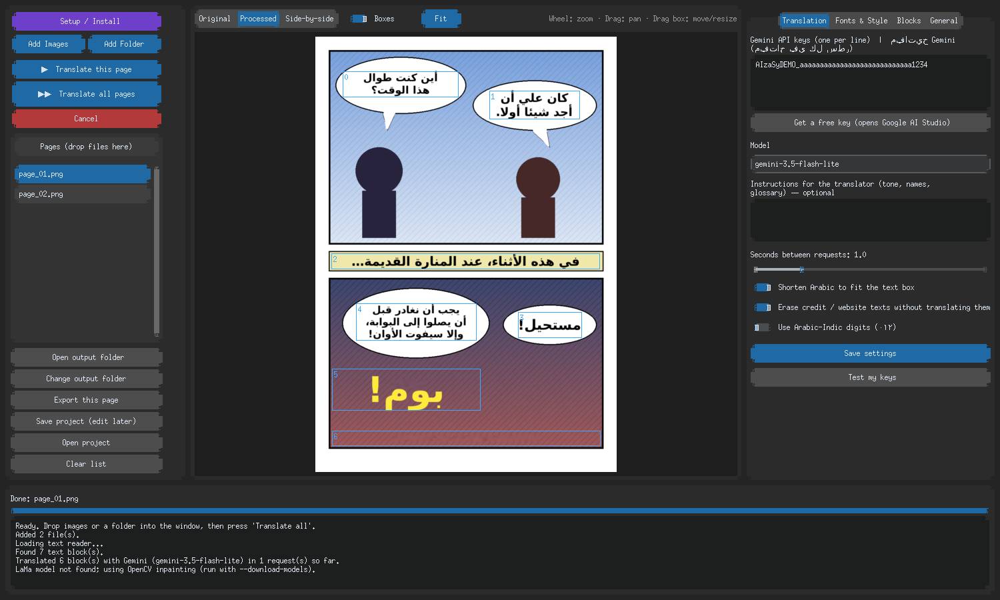

# 🔑 مفاتيح جمناي

الترجمة في البرنامج تتم عبر **Google Gemini** فقط.

## الحصول على مفتاح مجاني
1. افتح https://aistudio.google.com/apikey وسجّل بحساب جوجل.
2. اضغط **Create API key** وانسخ المفتاح (يبدأ بـ `AIza`).
3. في البرنامج: تبويب **Translation** ← الصق المفتاح في الصندوق ← **Save settings** ← **Test my keys**.



## عدة مفاتيح
ضع كل مفتاح في سطر. يستخدمها البرنامج بالتناوب، وإن وصل أحدها للحد يؤجله ويكمل بالآخر، والمفتاح المرفوض يُستبعد.

> ⚠️ الحد المجاني لجوجل يُحسب لكل **مشروع** (Google Cloud project) لا لكل مفتاح. مفتاحان من نفس المشروع يتشاركان نفس الحد. لزيادة الحد فعليًا أنشئ المفاتيح في مشاريع/حسابات مختلفة.

## كيف يرسل البرنامج الطلبات؟
- **طلب واحد لكل صفحة** (وكل 40 كتلة كحد أقصى في الطلب).
- فاصل لا يقل عن **ثانية** بين أي طلبين (قابل للتعديل من الشريط في التبويب).
- الجواب JSON بصيغة `{"translations":[{"id":0,"text":"..."}]}`؛ إن نقص رقم يُعاد طلبه وحده.
- كل كتلة تُرسل مع **نوعها** (حوار، سرد، همس، مؤثر صوتي) و**حد الأحرف** المناسب لمربعها.

## حقل التعليمات
اكتب فيه ما يخص عملك، مثلًا:
```
اسم البطل: «كاي». خاطب الشخصيات بصيغة غير رسمية. اترك «Senpai» كما هي.
```

## النماذج والاحتياطي
في تبويب **Translation ← Models** اختر **Main model** وحتى نموذجين احتياطيين (**Backup model 1/2**)، أو اضغط **↻ Load the models my key can use** ليسأل جوجل عن النماذج المتاحة لمفتاحك.
- إذا لم يوجد النموذج أو انتهت حصته (حد يومي) ينتقل البرنامج تلقائيًا للاحتياطي ثم يعود للأساسي عندما يتوفر.
- الافتراضي `gemini-3.5-flash-lite` ثم `gemini-flash-latest` ثم `gemini-2.5-flash`.

## الاتساق بين الصفحات (Consistency)
- **Remember names and story between pages:** يرسل البرنامج ملخصًا قصيرًا وقاموس أسماء وآخر 5 جمل، ويطلب تحديثها مع كل صفحة، فتثبت الأسماء والنبرة طوال الفصل. زر **Forget the story** عند بدء سلسلة جديدة.
- **Show Gemini the page picture:** يرسل صورة الصفحة بصناديق مرقمة ليصحح أخطاء قراءة النص (OCR). أدق لكنه يستهلك حصة أكثر، وهو مطفأ افتراضيًا.
- إن نقصت كتل من الجواب يُعاد طلبها، وإن بقيت ناقصة تبقى بنصها الإنجليزي ويُسجَّل ذلك بدل أن تفشل الصفحة كلها.

## الأمان
المفاتيح تُحفظ في `config/settings.json` على جهازك فقط، ولا تظهر في رسائل الخطأ. لا تشارك هذا الملف.
