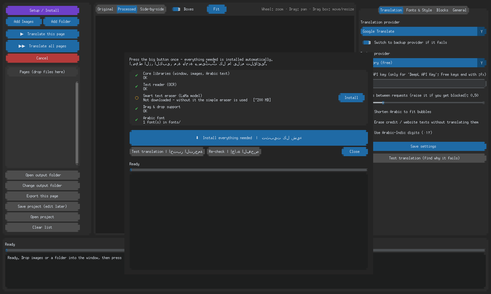
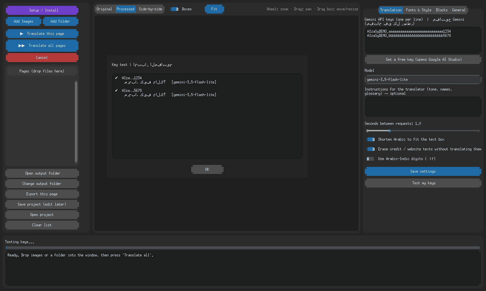
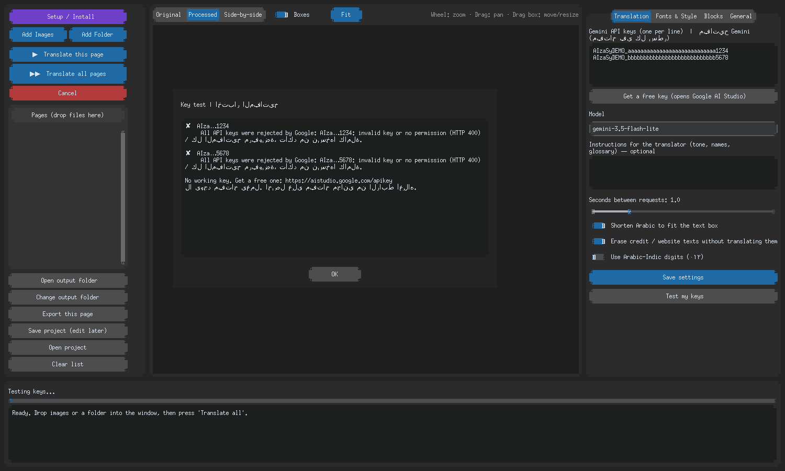

# 🛠️ التثبيت

## الطريقة الأسهل: ملف جاهز (بدون بايثون)
من [Releases](https://github.com/fang3yuan/comic-translator-app/releases/latest) نزّل `ComicTranslator-Setup.exe` وشغّله (أو انقر `Install.bat` من المشروع). ثم افتح **Setup / Install** لتنزيل نموذج LaMa (اختياري)، وانتقل إلى [مفاتيح جمناي](GEMINI.md). لبناء الملف بنفسك: [BUILD.md](BUILD.md).

## أو التشغيل من الكود

> تحتاج هذه الخطوات **مرة واحدة فقط**. بعدها يفتح البرنامج بنقرتين.

[← الرئيسية](../README.md) · [الاستخدام →](USAGE.md)

---

## 1) تثبيت بايثون

1. افتح https://www.python.org/downloads/ وحمّل **Python 3.11 أو أحدث**.
2. شغّل المثبّت.
3. **ويندوز:** في أول شاشة ضع علامة ✔ على **Add python.exe to PATH**، ثم **Install Now**.

> 💡 لا تعرف إن كان بايثون مثبّتًا؟ شغّل `Start.bat`؛ إن لم يجده سيفتح لك صفحة التحميل.

| النظام | ملاحظة |
|--------|--------|
| ويندوز | الخطوات أعلاه تكفي |
| ماك | حمّل المثبّت من نفس الرابط (أو `brew install python-tk`) |
| أوبونتو/ديبيان | `sudo apt install python3 python3-venv python3-tk` |
| فيدورا | `sudo dnf install python3 python3-tkinter` |

---

## 2) تشغيل البرنامج

فك ضغط المجلد في مكان دائم (مثل سطح المكتب)، ثم:

| النظام | الأمر |
|--------|-------|
| 🪟 ويندوز | انقر مرتين على **`Start.bat`** |
| 🍎🐧 ماك/لينكس | `bash start.sh` داخل المجلد |

### ماذا يحدث في أول تشغيل؟

| الخطوة | الحجم التقريبي | المدة |
|--------|----------------|-------|
| إنشاء بيئة بايثون خاصة (لا تؤثر على جهازك) | صغير | ثوانٍ |
| تنزيل المكتبات (النافذة، الصور، القراءة، العربية) | 150 ميغابايت | 2–5 دقائق |
| تنزيل نموذج المسح الذكي LaMa | 200 ميغابايت | 1–3 دقائق |

- **لا تغلق النافذة السوداء** حتى يفتح البرنامج.
- في المرات القادمة يفتح فورًا.
- إن انقطع الإنترنت أثناء تنزيل LaMa، يبدأ البرنامج بالمسح البسيط، ويمكنك تنزيله لاحقًا من نافذة Setup.

---

## 3) نافذة Setup (فحص كل شيء)

افتحها من الزر البنفسجي **🛠 Setup / Install** في أي وقت.

- علامة ✔ = المكوّن جاهز.
- إن كان ينقص شيء، اضغط الزر الكبير **⬇ Install everything needed**.
- بعد تثبيت **Drag & drop** لأول مرة، أغلق البرنامج وافتحه مرة ثانية.

---

## 4) أضف مفتاح جمناي وتحقق

1. في تبويب **Translation** اضغط **Get a free key**، أنشئ المفتاح والصقه ([التفاصيل](GEMINI.md)).
2. اضغط **Test my keys**، يجب أن ترى ✔ بجانب كل مفتاح صالح.

ظهرت ✘؟ اقرأ السبب المكتوب (مفتاح مرفوض، حد الاستخدام، لا إنترنت) أو انتقل إلى [حل المشاكل](TROUBLESHOOTING.md).

---

## 🧹 إلغاء التثبيت

احذف المجلد كله. البرنامج لا يكتب أي شيء خارجه (البيئة الخاصة في `.venv` داخله).

## 🔄 تحديث البرنامج

فك ضغط النسخة الجديدة فوق القديمة (أو في مجلد جديد). إن ظهرت أخطاء مكتبات بعد التحديث، احذف مجلد `.venv` وشغّل `Start.bat` من جديد.
