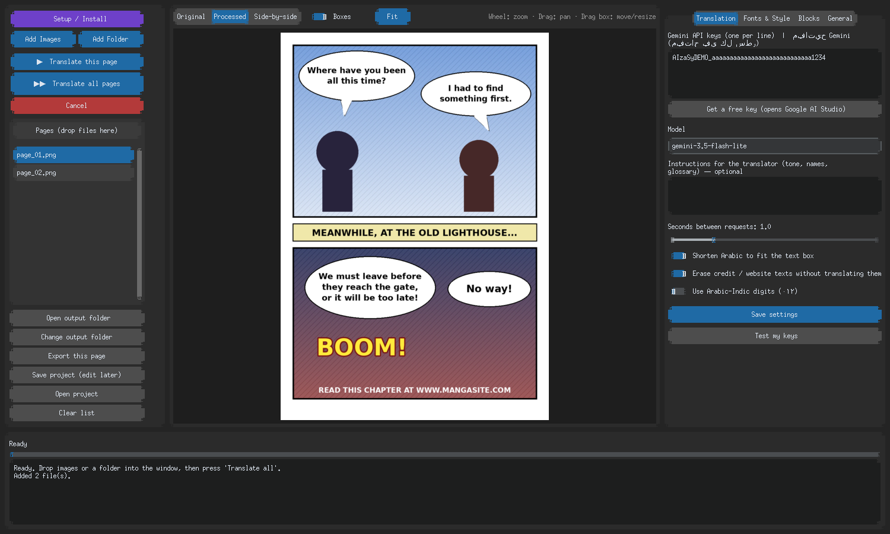
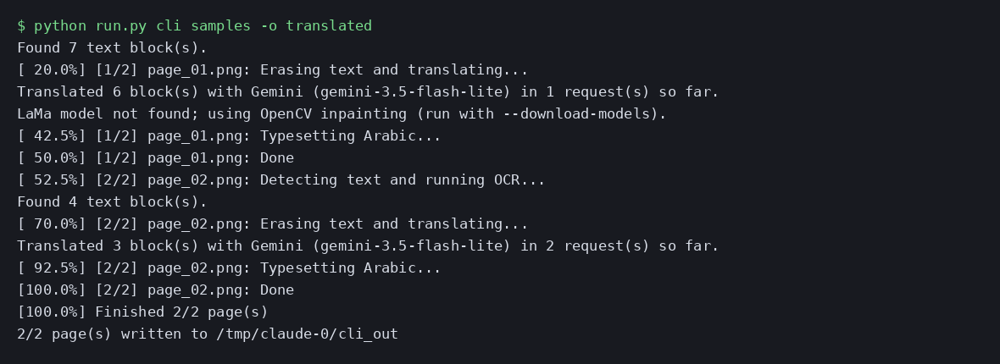
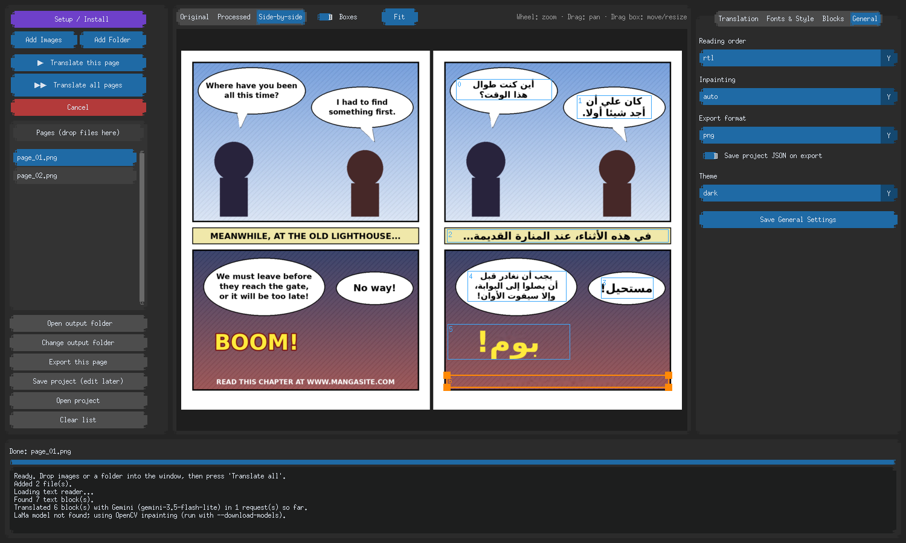
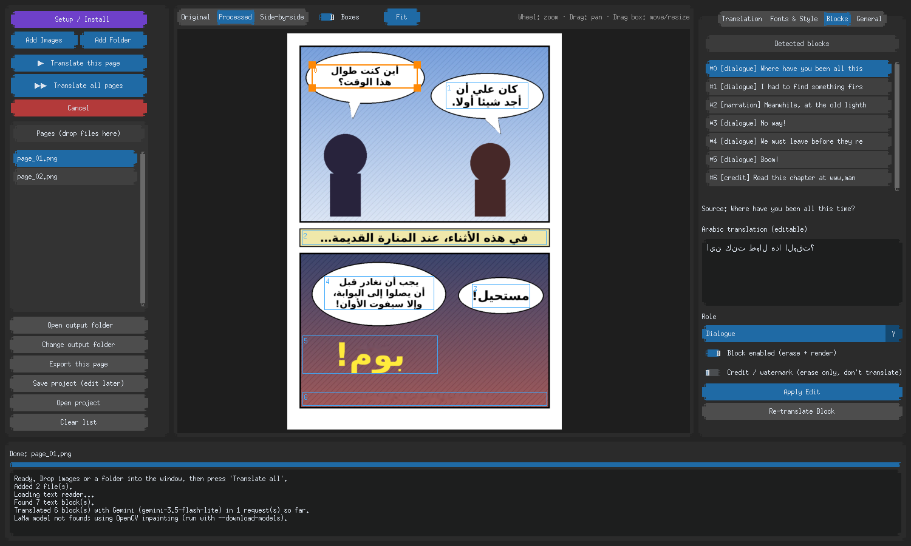
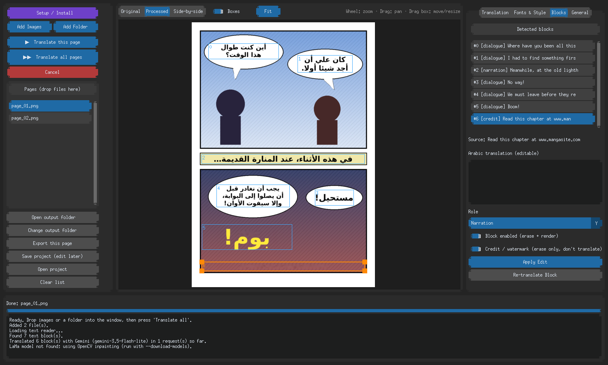
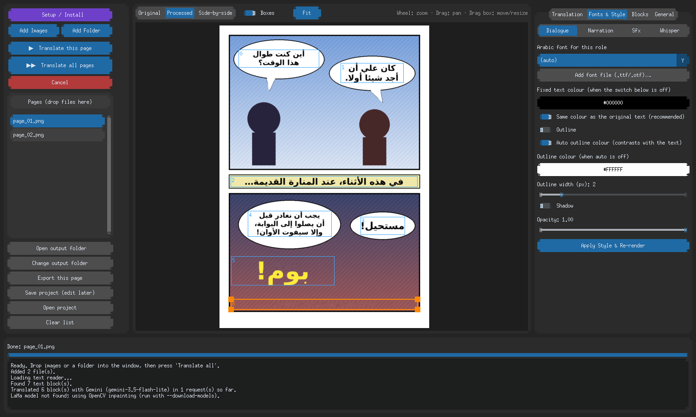

# 🖱️ دليل الاستخدام

[← التثبيت](INSTALL.md) · [حل المشاكل →](TROUBLESHOOTING.md)

---

## 1) إضافة الصفحات

**الأسهل:** اسحب الصور (أو مجلدًا كاملًا) وأفلتها داخل النافذة.
أو استخدم الزرين **Add Images** / **Add Folder**.



يدعم البرنامج PNG وJPG وWEBP. تظهر الصفحات في القائمة اليسرى.

---

## 2) الترجمة

| الزر | ماذا يفعل |
|------|-----------|
| **▶ Translate this page** | يترجم الصفحة المحددة فقط (مناسب للتجربة) |
| **▶▶ Translate all pages** | يترجم كل الصفحات ويحفظ كل صفحة فور انتهائها |
| **Cancel** | يوقف بعد الصفحة الحالية |


النتائج تُحفظ تلقائيًا في مجلد **`translated`** بجانب صورك. زر **📂 Open output folder** يفتحه.



---

## 3) تعديل النتيجة



### على الصفحة
- **عجلة الفأرة:** تكبير وتصغير. **السحب:** تحريك الصفحة.
- **اسحب مربع النص** لتحريكه، و**اسحب زواياه** لتغيير مساحة النص.
- **Original / Processed / Side-by-side:** عرض الأصل أو النتيجة أو الاثنين معًا.
- **Boxes:** إظهار أو إخفاء المربعات. **Fit:** ملاءمة الصفحة للنافذة.

### تبويب Blocks (كل كتلة نص)



| الخيار | الاستخدام |
|--------|-----------|
| **Arabic translation** | عدّل الترجمة بيدك (أو اختصرها إن طالت) |
| **Role** | نوع النص: حوار / سرد / صوت / همس (لكل نوع خط خاص) |
| **Block enabled** | أوقفه إن لم تُرد مسح هذه الكتلة ولا ترجمتها |
| **Credit / watermark** | علّمه إن كان نص حقوق: يُمسح بدون ترجمة |
| **Apply Edit** | يطبّق تعديلاتك على الصفحة |
| **Re-translate Block** | يعيد ترجمة هذه الكتلة فقط |

### نصوص الحقوق والمواقع
يكتشف البرنامج تلقائيًا نصوصًا مثل «اقرأ الفصل على site.com» أو «Translated by…»، فيمسحها بدون ترجمة، وتظهر بوسم `[credit]`.



لإيقاف ذلك: تبويب **Translation** ← أطفئ *Erase credit / website texts*.

---

## 4) تبويب الترجمة (جمناي)


| الخيار | الشرح |
|--------|-------|
| **Gemini API keys** | مفتاح أو أكثر، واحد في كل سطر ([كيف أحصل عليها؟](GEMINI.md)) |
| **Get a free key** | يفتح صفحة إنشاء المفتاح |
| **Model** | الافتراضي `gemini-3.5-flash-lite`، مع احتياطي تلقائي |
| **Instructions for the translator** | أسماء الشخصيات، النبرة، قاموس... تُضاف للبرومت |
| **Seconds between requests** | الفاصل بين الطلبات (الافتراضي 1.0 ولا ينزل عن ذلك) |
| **Shorten Arabic to fit the text box** | يطلب من جمناي حدًّا لطول كل جملة بحسب مربعها |
| **Erase credit / website texts** | يمسح نصوص الحقوق بدون ترجمة |
| **Use Arabic-Indic digits** | أرقام عربية ٠١٢ |
| **Test my keys** | يختبر كل مفتاح ويشرح سبب الفشل |

الترجمة **طلب واحد للصفحة**: كل الكتل المكتشفة تُرسل معًا ويعود الجواب منسّقًا.

الترجمة تُكتب في **نفس مربع النص المكتشف** (يتسع قليلًا فقط داخل مساحة فارغة مؤكدة). إن كان الخط صغيرًا جدًا فعدّل الترجمة بيدك من تبويب Blocks، أو كبّر المربع بالسحب.

---

## 5) الخطوط والألوان



- لكل نوع نص (حوار/سرد/صوت/همس) خط خاص.
- **Same colour as the original text** مفعّل افتراضيًا: العربية بنفس لون الأصل (أسود، أبيض، ملوّن).
- **Outline / Shadow:** حدود وظل للنص. **Auto outline colour** يختار الحد بما يناسب اللون.
- **Add font file:** أضف أي خط عربي `.ttf`/`.otf` (جرّب خطوطًا من fonts.google.com مثل Cairo وTajawal وReem Kufi).
- اضغط **Apply Style & Re-render** لتطبيق التغيير.

---

## 6) الحفظ والعودة للتعديل لاحقًا

- **Save project (edit later):** يحفظ ملف `.json` ونسخة نظيفة من الصفحة.
- **Open project:** يفتح الملف لتكمل التعديل.
- التصدير الافتراضي PNG؛ غيّره من تبويب **General** (PNG / JPG / WEBP).

---

## ⌨️ سطر الأوامر

```bash
python run.py cli صفحة.png -o output
python run.py cli مجلد_الفصل/ -o output --order rtl --format jpg
python run.py cli --download-models
```

| الخيار | المعنى |
|--------|--------|
| `-o` | مجلد النتائج |
| `--key` | مفتاح جمناي (كرّره لعدة مفاتيح) أو متغير البيئة `GEMINI_API_KEY` |
| `--model` | اسم الموديل |
| `--order rtl/ltr` | اتجاه القراءة |
| `--format` | `png` / `jpg` / `webp` |
| `--inpaint` | `auto` / `lama` / `telea` / `ns` |
